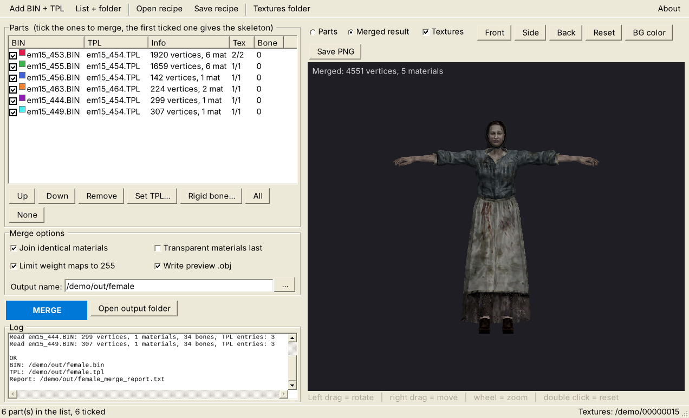
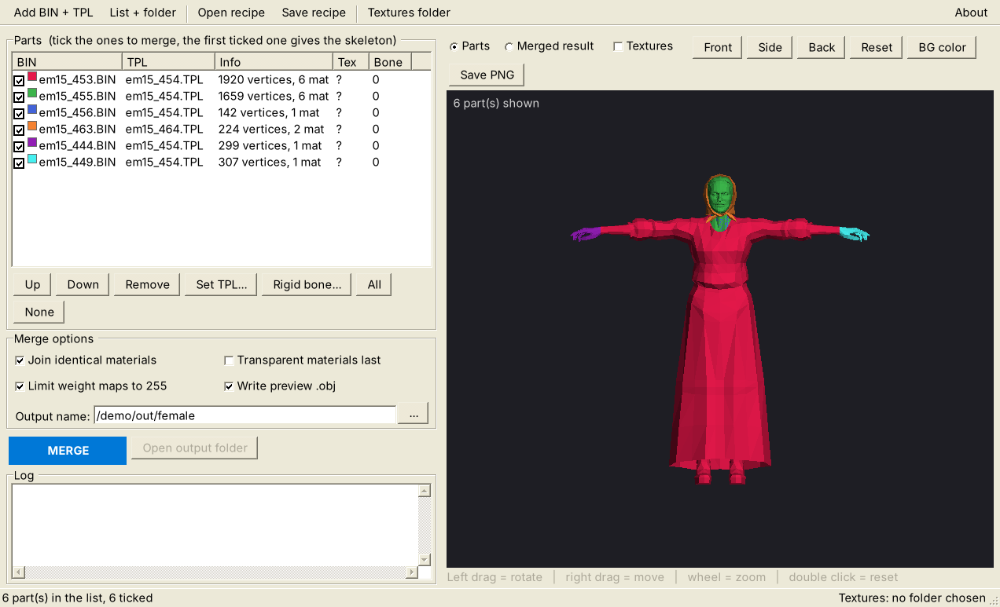

<div align="center">

# RE4 UHD BIN + TPL Merge Tool

**Merge the parts of a Resident Evil 4 UHD model (body, head, neck, hands...) into one BIN + one TPL.**

[English](README.md) | [العربية](README_AR.md)

[](https://github.com/YEMENI-modder/Re4UhdBinMerge/actions/workflows/build.yml)
[](LICENSE)
[](https://dotnet.microsoft.com/download/dotnet-framework/net48)
[](#requirements)
[](https://github.com/YEMENI-modder/Re4UhdBinMerge/releases)
[](#credits)



</div>

## What it does
In RE4 UHD a character is split into several `.BIN` files (body, head, neck, hands, head cover...), each with a `.TPL` texture table. Putting them together by hand means fixing bone IDs, texture indexes and weight maps. This tool does it for you:

- merges the **TPL** files (identical textures are joined) and fixes the texture index of every material;
- merges the **skeleton** (first part decides) and the **weight maps**, with the 255 weight-map limit handled;
- optionally joins identical materials and puts transparent ones last;
- writes `name.bin`, `name.tpl`, a text **report**, and a preview `.obj`, then **reads the result back** to check it;
- shows a **3D preview with textures** (DDS and TGA) before and after the merge, no GPU needed.

Only the **UHD** BIN/TPL format is supported.

## Screenshots
| Before: the 6 parts, one color each | After: merged result with textures |
|---|---|
|  |  |

Example: the **em15** female villager = body `em15_453` + head `em15_455` + neck `em15_456` + head cover `em15_463` + hands `em15_444` and `em15_449`.
(Screenshots were taken with the tool running under Mono; on Windows the fonts look slightly different.)

## Requirements
Windows with **.NET Framework 4.8** (already included in Windows 10/11). Nothing to install.

## Download
Get `RE4_UHD_BIN_MERGE.zip` from the [Releases](https://github.com/YEMENI-modder/Re4UhdBinMerge/releases) page and unzip it.

## How to use (window)
1. Extract your model files (`.BIN` + `.TPL`).
2. Click **Add BIN + TPL** (or drag the files onto the window). The TPL is searched automatically; use **Set TPL...** if it guessed wrong. Hands and necks are shared, so give them the TPL of the body they are merged with.
3. Tick the parts to merge. **The first ticked part gives the skeleton.**
4. *(Optional)* click **Textures folder** and pick the folder with the DDS/TGA files (for example the extracted `00000015` folder) to see the model textured.
5. Choose the output name and press **MERGE**. Check the **Merged result** view and the log.

The game only reads **DDS** and **TGA** textures, so those are the formats the preview reads. A texture is found as `0051.dds` / `0051.tga` (the TextureID from the TPL) inside the folder you picked, or inside a `00000015` sub-folder.

Mouse in the view: left drag = rotate, right drag = move, wheel = zoom, double click = reset.

## Command line
```
RE4_UHD_BIN_MERGE.exe recipe.merge.txt
RE4_UHD_BIN_MERGE.exe -o merged  body.bin body.tpl  head.bin head.tpl  hand.bin hand.tpl
options: --transparent-last  --no-join  --no-obj  --no-weight-limit
```
A recipe (see [`Examples/`](Examples)):
```
Output: out/female
Textures: 00000015
Part: em15_453.BIN, em15_454.TPL
Part: em15_455.BIN, em15_454.TPL
Part: em15_463.BIN, em15_464.TPL
Part: em15_444.BIN, em15_454.TPL, bone=12
```
`bone=N` = bone used by a rigid part (no weights) when other parts are weighted.

## Build from source
```
dotnet build src/RE4_UHD_BIN_MERGE.csproj -c Release
```
GitHub Actions builds every push and attaches a zip to each release tag (`v1.0.0`...). Details for contributors and AI assistants: [AGENTS.md](AGENTS.md).

## Known limits
- The merged model has **not been tested inside the game yet**. Please report results in Issues.
- With more than 255 weight maps the weights are rounded (tiny skinning change). Turn the option off if you use the Qingsheng DLL.
- Preview textures: DXT1-5 / uncompressed DDS and TGA. DX10-header DDS (BC7...) is not supported.
- The preview is a simple viewer: diffuse texture + opacity mask, flat lighting.

## Credits
- **Tool by [YEMENI-modder](https://github.com/YEMENI-modder).**
- **The code was written entirely by AI - Claude Sonnet 5.5 (Anthropic).** Claude Sonnet 5.5 did all the programming, the UI and the docs; YEMENI-modder directed the project and did all the testing.
- BIN/TPL code: **JADERLINK** (RE4-UHD-BIN-TPL-TOOLS, MIT).
- **TGASharpLib** - Alex Green (MIT) - reads TGA.
- **DDSReaderSharp** - Alex Green (MIT), based on DDSReader.java by Kenji Sasaki (MIT) - reads DDS.

Full license texts: [THIRD_PARTY_LICENSES.md](THIRD_PARTY_LICENSES.md).

## License
[MIT](LICENSE) - Copyright (c) 2026 YEMENI.
Resident Evil 4 is a trademark of Capcom. This is a fan-made tool; it contains no game files.
