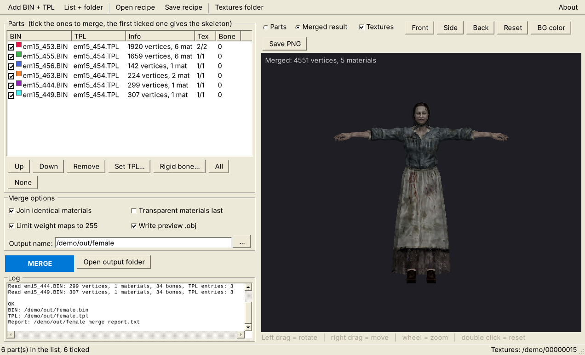
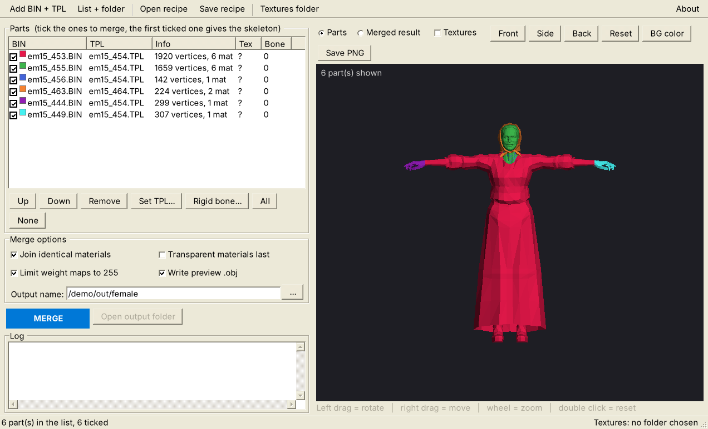

<div align="center">

# RE4 UHD BIN + TPL Merge Tool

**أداة لدمج أجزاء موديل Resident Evil 4 UHD (الجسم، الرأس، الرقبة، اليدين...) في ملف BIN واحد وملف TPL واحد.**

[English](README.md) | [العربية](README_AR.md)

[](https://github.com/YEMENI-modder/Re4UhdBinMerge/actions/workflows/build.yml)
[](LICENSE)
[](https://dotnet.microsoft.com/download/dotnet-framework/net48)
[](#المتطلبات)
[](https://github.com/YEMENI-modder/Re4UhdBinMerge/releases)
[](#الحقوق)



</div>

<div dir="rtl">

## ماذا تفعل الأداة؟
في RE4 UHD تكون الشخصية مقسومة إلى عدة ملفات `.BIN` (جسم، رأس، رقبة، يدين، غطاء رأس...) ولكل منها ملف `.TPL` للخامات. دمجها يدوياً يعني تعديل أرقام العظام وأرقام الخامات وخرائط الأوزان. الأداة تسوي هذا تلقائياً:

- تدمج ملفات **TPL** (الخامات المتطابقة تتوحد) وتصحح رقم الخامة في كل مادة.
- تدمج **الهيكل العظمي** (أول جزء يحدد الهيكل) و**خرائط الأوزان** مع التعامل مع حد 255.
- تدمج المواد المتطابقة اختيارياً، وتضع المواد الشفافة في الآخر.
- تكتب `name.bin` و`name.tpl` و**تقرير** نصي وملف `.obj` للمعاينة، ثم **تقرأ الناتج من جديد** للتأكد منه.
- تعرض **معاينة ثلاثية الأبعاد بالخامات** (DDS و TGA) قبل الدمج وبعده، بدون كرت شاشة.

الأداة تدعم صيغة **UHD** فقط.

## صور من البرنامج
| قبل: الأجزاء الستة، لكل جزء لون | بعد: الناتج المدموج بالخامات |
|---|---|
|  |  |

المثال: القروية **em15** = الجسم `em15_453` + الرأس `em15_455` + الرقبة `em15_456` + غطاء الرأس `em15_463` + اليدين `em15_444` و`em15_449`.
(اللقطات مأخوذة والأداة تعمل على Mono، فالخطوط في ويندوز تختلف قليلاً.)

## المتطلبات
ويندوز مع **.NET Framework 4.8** (موجود في ويندوز 10 و11). ما تحتاج تثبّت شيء.

## التحميل
حمّل `RE4_UHD_BIN_MERGE.zip` من صفحة [Releases](https://github.com/YEMENI-modder/Re4UhdBinMerge/releases) وفك الضغط.

## طريقة الاستخدام (النافذة)
1. استخرج ملفات الموديل (`.BIN` و`.TPL`).
2. اضغط **Add BIN + TPL** (أو اسحب الملفات على النافذة). الـ TPL يُبحث عنه تلقائياً، وإذا أخطأ استخدم **Set TPL...**. اليدان والرقبة مشتركة، فأعطها TPL الجسم الذي ستُدمج معه.
3. علّم الأجزاء المراد دمجها. **أول جزء معلَّم يحدد الهيكل العظمي.**
4. *(اختياري)* اضغط **Textures folder** واختر مجلد ملفات DDS/TGA (مثل المجلد المستخرج `00000015`) لترى الموديل بالخامات.
5. اختر اسم الإخراج واضغط **MERGE**. شاهد **Merged result** وسجل الأحداث.

اللعبة تقرأ خامات **DDS** و**TGA** فقط، ولهذا هذه هي الصيغ التي تقرأها المعاينة. الخامة تُوجد باسم `0051.dds` أو `0051.tga` (رقم TextureID من الـ TPL) داخل المجلد المختار، أو داخل مجلد فرعي اسمه `00000015`.

الماوس في المعاينة: سحب بالزر الأيسر = تدوير، بالأيمن = تحريك، العجلة = تكبير، نقر مزدوج = إعادة الضبط.

## سطر الأوامر
```
RE4_UHD_BIN_MERGE.exe recipe.merge.txt
RE4_UHD_BIN_MERGE.exe -o merged  body.bin body.tpl  head.bin head.tpl  hand.bin hand.tpl
options: --transparent-last  --no-join  --no-obj  --no-weight-limit
```
مثال وصفة (انظر مجلد [`Examples/`](Examples)):
```
Output: out/female
Textures: 00000015
Part: em15_453.BIN, em15_454.TPL
Part: em15_455.BIN, em15_454.TPL
Part: em15_463.BIN, em15_464.TPL
Part: em15_444.BIN, em15_454.TPL, bone=12
```
`bone=N` = العظمة التي يستخدمها جزء صلب (بدون أوزان) عندما تكون بقية الأجزاء لها أوزان.

## البناء من المصدر
```
dotnet build src/RE4_UHD_BIN_MERGE.csproj -c Release
```
GitHub Actions يبني المشروع مع كل push ويرفق ملف zip بكل إصدار (`v1.0.0`...). تفاصيل للمطورين وللذكاء الاصطناعي في [AGENTS.md](AGENTS.md).

## حدود معروفة
- الموديل المدموج **لم يُجرَّب داخل اللعبة بعد**. نرجو إبلاغنا بالنتائج في Issues.
- إذا زادت خرائط الأوزان عن 255 تُقرَّب الأوزان (تغيير بسيط في الـ skinning). أطفئ الخيار إذا تستخدم Qingsheng DLL.
- خامات المعاينة: DDS من نوع DXT1 إلى DXT5 أو غير مضغوط، و TGA. صيغة DDS برأس DX10 (مثل BC7) غير مدعومة.
- المعاينة بسيطة: خامة الألوان وقناع الشفافية فقط، مع إضاءة مسطحة.

<a id="الحقوق"></a>
## الحقوق
- **الأداة من صنع [YEMENI-modder](https://github.com/YEMENI-modder).**
- **الكود كُتب بالكامل بالذكاء الاصطناعي - Claude Sonnet 5.5 من Anthropic.** Claude Sonnet 5.5 سوّى كل البرمجة والواجهة والتوثيق، وYEMENI-modder وجّه المشروع وسوّى كل الاختبارات.
- كود BIN/TPL: **JADERLINK** (RE4-UHD-BIN-TPL-TOOLS, MIT).
- **TGASharpLib** - Alex Green (MIT) - لقراءة TGA.
- **DDSReaderSharp** - Alex Green (MIT)، مبنية على DDSReader.java لـ Kenji Sasaki (MIT) - لقراءة DDS.

نصوص التراخيص كاملة: [THIRD_PARTY_LICENSES.md](THIRD_PARTY_LICENSES.md).

## الرخصة
[MIT](LICENSE) - Copyright (c) 2026 YEMENI.
Resident Evil 4 علامة تجارية لشركة Capcom. هذه أداة من صنع المعجبين ولا تحتوي على أي ملفات من اللعبة.

</div>
